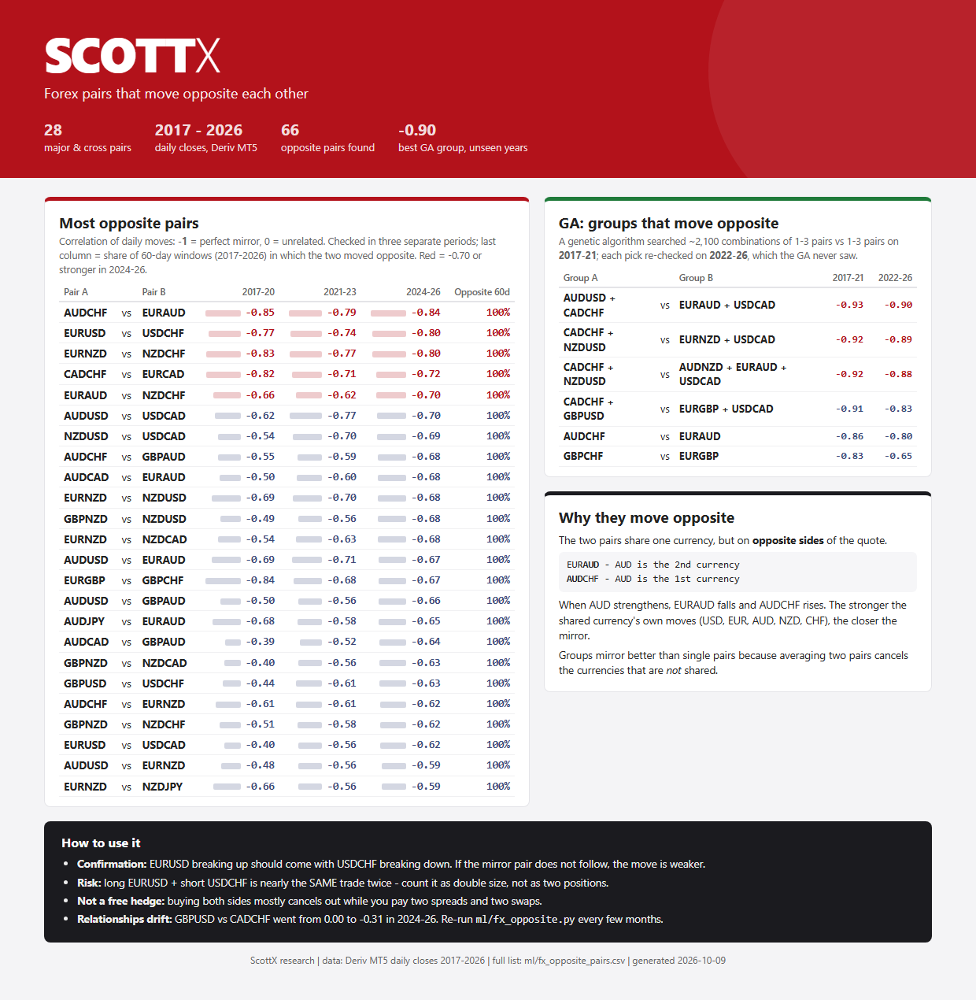

# Forex pairs that move opposite each other

Which of 28 major and cross forex pairs move opposite each other, and which **groups** of pairs mirror each other best. Deriv MT5 daily closes, 2017-2026.

## What is here

| File | Contents |
|---|---|
| [Opposite_Forex_Pairs.pdf](Opposite_Forex_Pairs.pdf) / [.html](Opposite_Forex_Pairs.html) | The report |
| [Opposite_Forex_Pairs.csv](Opposite_Forex_Pairs.csv) | Every pair combination: correlation in 2017-20, 2021-23, 2024-26, share of 60-day windows that were negative, worst period |
| [fx_opposite.py](fx_opposite.py) | The script: exhaustive pair correlations plus a genetic algorithm for groups |

## Method

1. **Every pair against every pair:** correlation of daily returns in three separate periods, plus the share of rolling 60-day windows in which they moved opposite. A relationship that holds in only one period shows up.
2. **Groups by genetic algorithm:** groups of 1-3 pairs against 1-3 pairs, searched on 2017-2021 and checked on 2022-2026, which the search never saw.

## Main results

- 66 opposite pairs. The strongest are stable in all three periods: AUDCHF vs EURAUD (-0.85 / -0.79 / -0.84), EURUSD vs USDCHF (-0.77 / -0.74 / -0.80), EURNZD vs NZDCHF.
- The best GA group, AUDUSD + CADCHF vs EURAUD + USDCAD, scored -0.93 on the search years and **-0.90 on the unseen years**.
- Why: the two pairs share one currency on opposite sides of the quote. Groups mirror better than single pairs because averaging cancels the currencies they do not share.

## Use

- **Confirmation:** a breakout on one pair should be matched by the opposite move on its mirror.
- **Risk:** long EURUSD + short USDCHF is nearly the same trade twice. Count it as double size.
- **Not a free hedge:** holding both sides mostly cancels out while paying two spreads and two swaps.

Run it on your own data: `python fx_opposite.py path/to/daily_csv_folder` (one CSV per pair with `time` and `close` columns).
